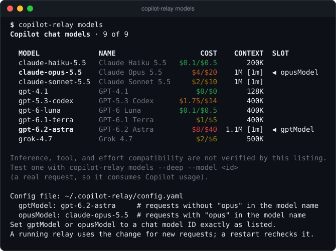
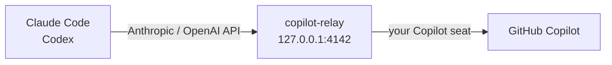

<div align="center">

# copilot-relay

**Use Claude Code and Codex with the models in your GitHub Copilot subscription.**

[](https://github.com/D0n9X1n/copilot-relay/actions/workflows/ci.yml) [](https://www.npmjs.com/package/copilot-relay) [](https://www.npmjs.com/package/copilot-relay) [](https://github.com/D0n9X1n/copilot-relay/releases/latest)
[](https://nodejs.org/) [](tsconfig.json) [](wiki/README.md) [](LICENSE)

**[Quick start](#quick-start)** · **[Everyday commands](#everyday-commands)** · **[Wiki](https://github.com/D0n9X1n/copilot-relay/wiki)** · **[中文](wiki/README.md)**



</div>



## Features

- **Claude Code, unchanged** — Messages API with streaming and tool calls; Codex CLI and app too, with no ChatGPT sign-in ([Codex](wiki/EN-Codex.md) · [中文](wiki/ZH-Codex.md)).
- **Two models, your choice** — `gptModel` (default `gpt-6.2-astra`) and `opusModel`, with the 1M window detected from Copilot's catalog ([Models](wiki/EN-Models.md) · [中文](wiki/ZH-Models.md)).
- **See what each model costs** — `copilot-relay models` lists every model with its price, from green for the cheapest to red for the dearest.
- **Full advertised capacity** — discovered context and output limits, with no silent trimming of your input.
- **WebSearch that fits the conversation** — relay-managed search, then an answer that can still use your tools.
- **Prompt-cache report** — hit rates per model and route from local logs, in red below your goal.
- **Diagnose offline** — debug mode records full bodies for `copilot-relay replay` (unredacted, so never share them wholesale).
- **Runs anywhere** — foreground or as a login service on macOS, Windows and Linux; set `apiKey` before binding beyond loopback.

## Quick start

You need **Node.js 22+**, **Claude Code**, and a GitHub account with Copilot access to the models you pick.

```sh
npm install -g copilot-relay
copilot-relay auth     # sign in with a device code
copilot-relay start    # keep it running; it sets up Claude Code and Codex
```

Then run `claude` in a **second terminal**. `copilot-relay setup` also sets up the desktop apps.
Settings live in `~/.copilot-relay/config.yaml` ([configuration guide](wiki/EN-Configuration.md));
behind a proxy, set `upstreamProxy` to its URL, or `env`, before `copilot-relay auth`.

## Everyday commands

| Command | What it shows |
| --- | --- |
| `copilot-relay status` | Is the relay up and usable; `--deep` also sends one real request through it |
| `copilot-relay models` | Every model with its price and context window; `models sol fast` prints the config line to use |
| `copilot-relay models --deep --model claude-opus-5.5` | Tests one model end to end (**consumes Copilot usage**) |
| `copilot-relay cache` | Prompt-cache hit rate per model; `--hourly`, `--daily`, `--since 6h`, `--json` |
| `copilot-relay usage` | Your Copilot plan and quota left, straight from GitHub |
| `copilot-relay stop` | Stops the relay when you are done |

Tab completion: `eval "$(copilot-relay completion zsh)"` in `~/.zshrc`. Every command and option is in [Commands](wiki/EN-Commands.md).

## Go further

**[Open the Wiki](https://github.com/D0n9X1n/copilot-relay/wiki)** · **[English / 中文](wiki/README.md)**

- [Configure models and deep checks](wiki/EN-Configuration.md) · [中文](wiki/ZH-Configuration.md)
- Run at login: [macOS](wiki/EN-macOS-LaunchAgent.md) · [Windows](wiki/EN-Windows-Service.md) · [Linux](wiki/EN-Linux-systemd.md)
- [GitHub Copilot app](wiki/EN-Copilot-App.md) · [Prompt caching](wiki/EN-Prompt-Caching.md) · [Troubleshoot](wiki/EN-Logging-Troubleshooting.md) · [Architecture](wiki/EN-Architecture.md) · [Contribute](wiki/EN-Development.md)

**Personal use only.** All forwarded usage runs on your own Copilot seat and limits; never let another person use your relay
([why](wiki/EN-Configuration.md#personal-use-only) · [中文](wiki/ZH-Configuration.md#仅限个人使用)).
Unofficial research project; not affiliated with GitHub, Anthropic or OpenAI. Upstream services and
compatibility can change; model and tool support are not guaranteed (see the Wiki). [MIT licensed](LICENSE).
